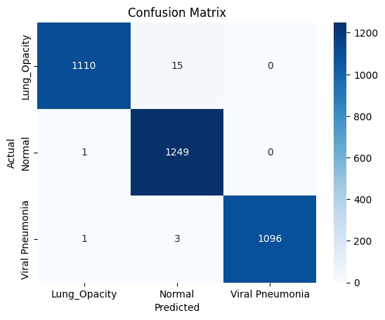

# Explainable Lung Disease Classification from Chest X-Rays

Chest X-ray classification into **Lung Opacity**, **Normal** and **Viral Pneumonia** using a fine-tuned **EfficientNetV2-S**, with **Integrated Gradients** to visualize the regions that drive the model's predictions.

## Overview

| | |
|---|---|
| **Task** | 3-class image classification |
| **Model** | EfficientNetV2-S (ImageNet-pretrained, custom 3-class head) |
| **Framework** | PyTorch, Torchvision |
| **Explainability** | Integrated Gradients (Captum) |
| **Dataset** | Lung X-Ray Image dataset (Kaggle): 3,475 images |

### Dataset

| Class | Images |
|---|---|
| Lung_Opacity | 1,125 |
| Normal | 1,250 |
| Viral Pneumonia | 1,100 |

The dataset is not included in this repo. Download it from Kaggle (search **"Lung Disease"**, folder `Lung X-Ray Image`).

## Pipeline

1. **Preprocessing:** resize to 224×224, random horizontal flip, color jitter, ImageNet normalization.
2. **Class imbalance:** inverse-frequency class weights in the cross-entropy loss.
3. **Model:** EfficientNetV2-S with its final layer replaced by a 3-class linear layer.
4. **Training:** Adam optimizer (lr = 1e-4), batch size 32, 10 epochs, on GPU.
5. **Evaluation:** classification report and confusion matrix.
6. **Explainability:** Integrated Gradients heatmaps overlaid on the X-rays.

## Results

Training accuracy went from **83.6%** after epoch 1 to **98.3%** after epoch 10.

| Class | Precision | Recall | F1-score |
|---|---|---|---|
| Lung_Opacity | 1.00 | 0.99 | 0.99 |
| Normal | 0.99 | 1.00 | 0.99 |
| Viral Pneumonia | 1.00 | 1.00 | 1.00 |

> **Note:** these metrics are measured on the training set. A held-out test split is planned to measure how well the model generalizes.

<p align="center">
  
  
</p>

## Repository Structure

```
lung-xray-xai/
├── lung_xray_classification.ipynb   # full pipeline: training, evaluation, prediction, XAI
├── images/                          # result plots used in this README
├── requirements.txt
├── LICENSE
└── README.md
```

## How to Run

**On Kaggle (easiest):**
1. Upload the notebook to Kaggle.
2. Add the Lung Disease dataset as input.
3. Turn on the GPU accelerator and run all cells.

**Locally:**
```bash
git clone https://github.com/user-230087/lung-xray-xai.git
cd lung-xray-xai
pip install -r requirements.txt
jupyter notebook lung_xray_classification.ipynb
```
Then change the dataset path in the notebook to wherever you saved the dataset.

## Future Work

- Add a train/validation/test split and report test accuracy
- Generate Integrated Gradients heatmaps from the fine-tuned model for every class
- Add Grad-CAM for comparison
- Save and load trained model weights

## License

Apache 2.0
